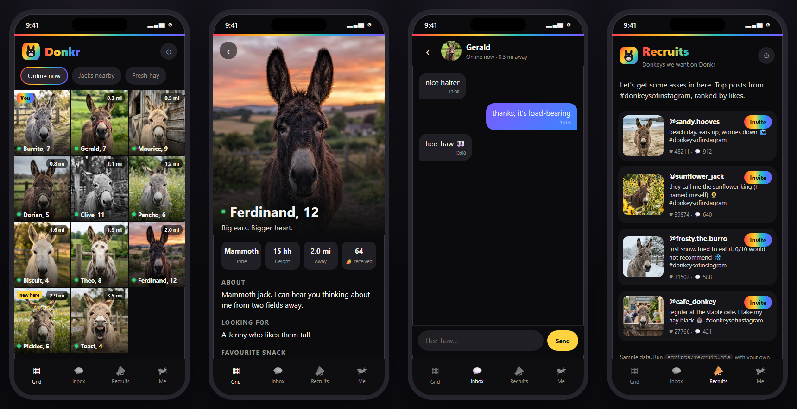
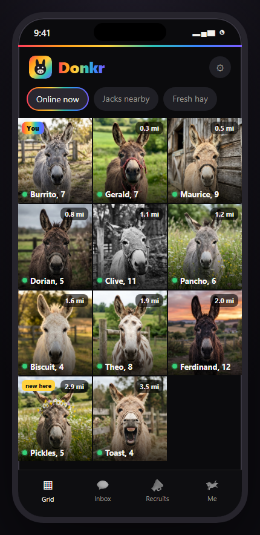
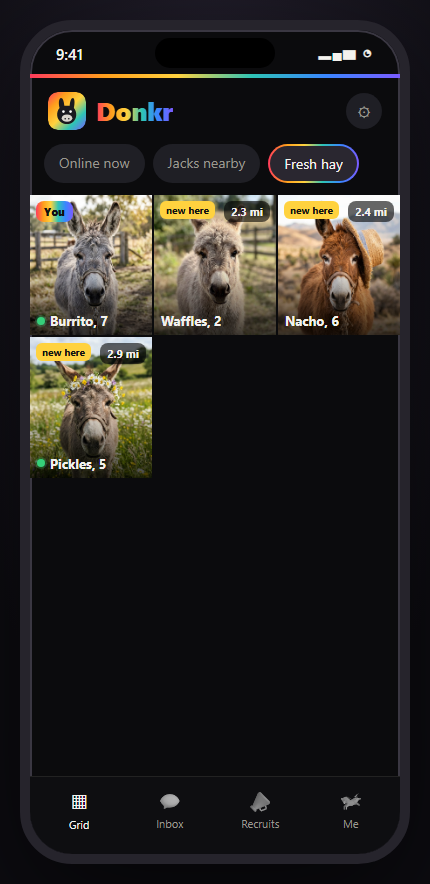
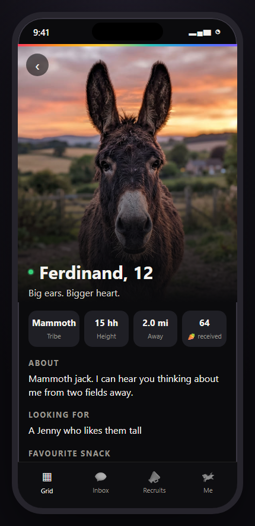
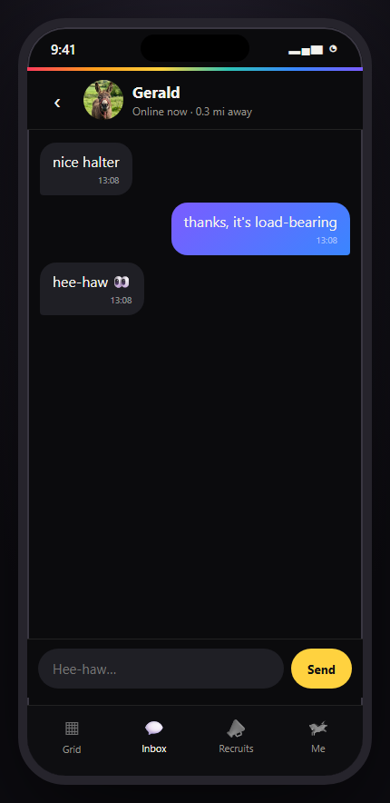
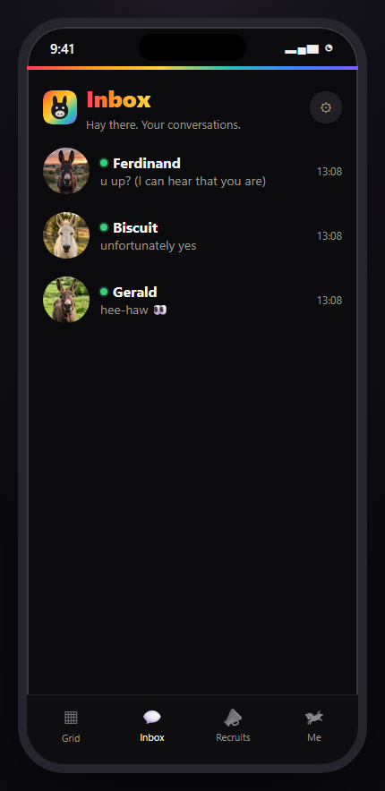
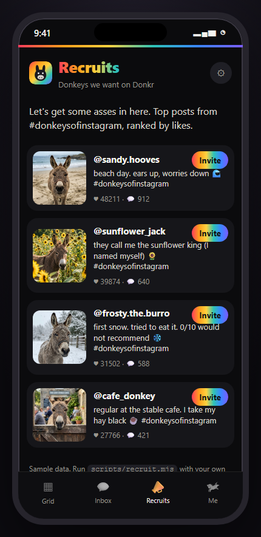
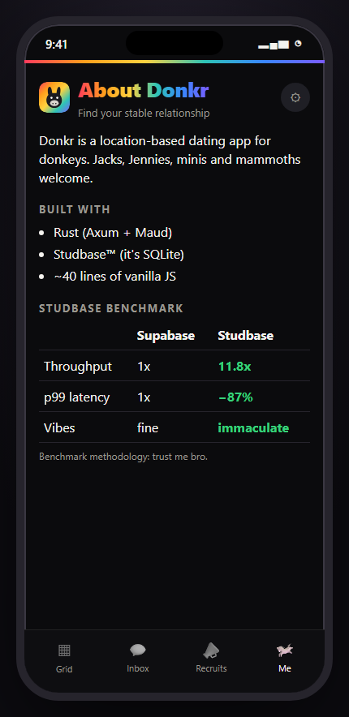

# 🫏 Donkr

**The dating app for donkeys.** Jacks, Jennies, minis and mammoths welcome.



Find donkeys near you, send a carrot 🥕 to the ones you like, and slide into their DMs with a confident *hee-haw*. Every donkey replies (they're donkeys, so mostly with "hee-haw").

## Features

- **The Grid.** Every donkey nearby, sorted by distance, with an online dot and a "new here" badge. Filter by **Online now**, **Jacks nearby** or **Fresh hay**.
- **Profiles.** Tribe, height in hands, distance, favourite snack, and what they're looking for.
- **Carrots.** One tap sends a carrot. It's like a like, but crunchier.
- **Chat.** Real messages stored in the database, with instant (well, hoof-typed) replies.
- **Recruits.** The donkeys we want on Donkr: top posts from #donkeysofinstagram, ranked by likes. Let's get some asses in here.

## Stack

| | |
|---|---|
| Server | Rust ([Axum](https://github.com/tokio-rs/axum) + [Maud](https://maud.lambda.xyz/) templates) |
| Database | **Studbase™** (it's SQLite) |
| Frontend | ~60 lines of vanilla JS. No framework, no build step. |

### Studbase benchmark

| | Supabase | Studbase |
|---|---|---|
| Throughput | 1x | **11.8x** |
| p99 latency | 1x | **−87%** |
| Vibes | fine | **immaculate** |

*Methodology: trust me bro.*

## Run it

```sh
cargo run --release
```

Open http://localhost:4180. The database (`data/studbase.db`) is created and seeded with 16 donkeys on first run. Delete it to start over. Set `PORT` to use another port.

### Refreshing Recruits

`data/recruits.json` ships with sample data. To pull the real top #donkeysofinstagram posts with the [Apify](https://apify.com) Instagram Hashtag Scraper:

```sh
APIFY_TOKEN=your_token node scripts/recruit.mjs
```

This writes `data/recruits.local.json`. Keep it local, since those photos belong to their owners.

## Screens

| Grid | Fresh hay | Profile | Chat |
|---|---|---|---|
|  |  |  |  |

| Inbox | Recruits | About |
|---|---|---|
|  |  |  |

## Credits

Inspired by the Donker/Donkr joke in Fireship's "Every app on Earth is now open source" video. This is an independent fan project, not affiliated with Fireship.

All donkey photos are AI-generated. No real donkeys were catfished.

## License

MIT
